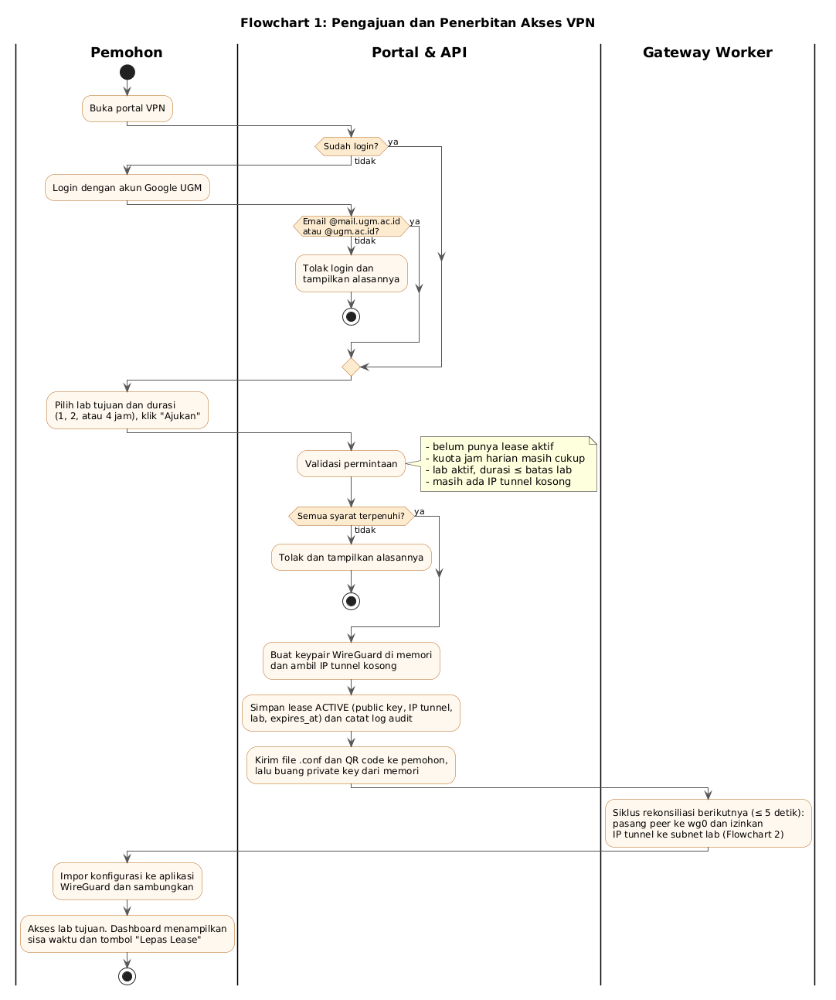
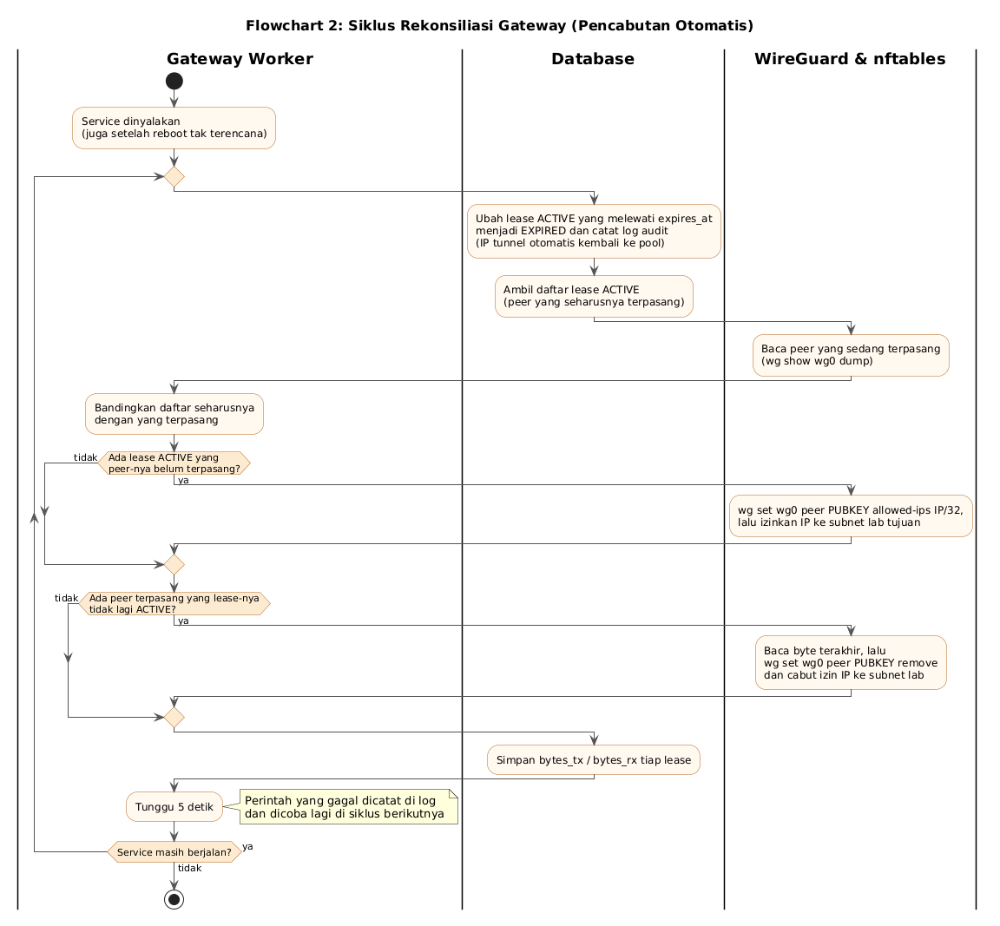
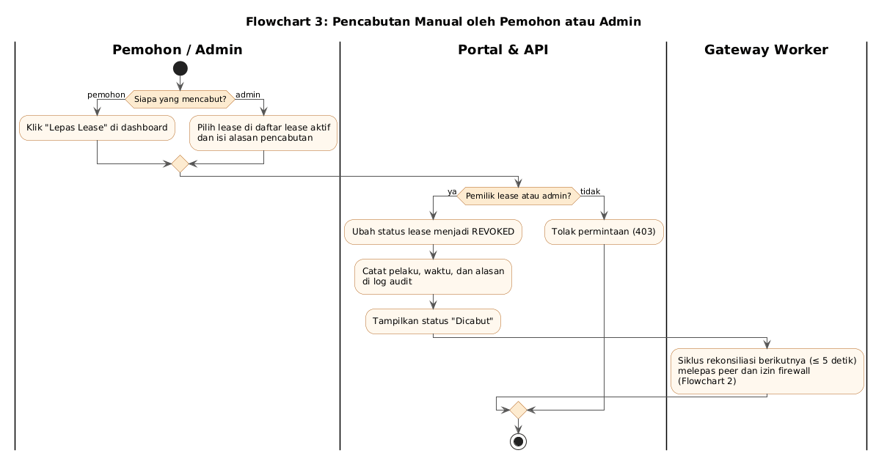

# ***Product Requirements Document***

Proyek: Ephemeral VPN Gateway (nama kerja)  
Tagline: *Self-Service Ephemeral Lab Access*  
Organisasi: Universitas Gadjah Mada, Komputasi Awan [kelas] Kelompok [nomor]  
*Project Manager*: [nama]  
Tanggal: 12/11/2026  
Versi: 1.1

# **Pendahuluan**

* **Latar belakang.** Akses jarak jauh ke laboratorium Teknologi Rekayasa Internet (TRI), Sekolah Vokasi UGM (Lab Cloud Computing, Cyber Security, dan Jaringan Komputer), saat ini diajukan lewat Google Form (ugm.id/PengajuanAksesVpnTRI), lalu diproses manual oleh admin.
* **Masalah.**
  * Pemohon menunggu berhari-hari hingga berminggu-minggu sampai profil VPN dibuat dan dikirim.
  * Profil VPN (.ovpn/sertifikat) tidak punya masa berlaku, sehingga kunci yang sudah tidak dipakai tetap valid tanpa batas.
  * VPN kampus membuka akses ke jaringan yang luas, bukan hanya ke lab yang dibutuhkan.
* **Solusi.** Ephemeral VPN Gateway adalah portal swalayan. Sivitas akademika login dengan akun Google UGM, memilih lab dan durasi, lalu langsung menerima konfigurasi WireGuard yang hanya bisa menjangkau lab tersebut. Saat durasi habis, akses dicabut otomatis.
* **Cakupan dokumen.** Dokumen ini mendeskripsikan *Proof of Concept* (PoC) yang berjalan di satu server Ubuntu (laptop) di jaringan rumah. Subnet lab disimulasikan di dalam server yang sama. Sebuah VPS ber-IPv4 publik hanya berperan sebagai *relay* agar klien dari internet bisa menjangkau *gateway*.

# **Tujuan**

PoC ini membuktikan bahwa:

* Akses VPN ke lab bisa diterbitkan sendiri oleh pemohon dalam hitungan detik, tanpa campur tangan admin.
* Setiap akses punya masa berlaku dan dicabut otomatis saat masa berlakunya habis.
* Setiap *peer* hanya bisa menjangkau subnet lab yang diminta dan tidak bisa menjangkau *peer* lain.
* Setiap penerbitan dan pencabutan akses tercatat dan bisa ditelusuri.

Target terukur:

* Waktu dari klik "Ajukan" sampai konfigurasi diterima: kurang dari 5 detik.
* 100% *lease* kedaluwarsa dicabut paling lambat 30 detik setelah masa berlakunya habis.
* Penurunan *throughput* lewat tunnel WireGuard kurang dari 10% dibanding *routing* langsung (diukur dengan iperf3).
* Sanggup melayani 100 *lease* aktif bersamaan di VM 2 vCPU dan RAM 2 GB.

# ***Stakeholder***

* **Pemohon (mahasiswa/peneliti).** Butuh akses sementara ke VM, router, atau node komputasi di lab untuk praktikum atau riset, dan mengharapkan akses langsung tanpa antre.
* **Admin/asisten lab.** Mengelola daftar lab, subnet, dan batas durasi, dan tidak ingin lagi membuat serta mengirim profil VPN secara manual.
* **Tim keamanan jaringan fakultas (SecOps).** Mengawasi keamanan jaringan kampus, dan mengharapkan tidak ada kredensial basi, akses seminimal mungkin, serta log terpusat.
* **Dosen pembimbing.** Menilai kesesuaian PoC dengan tujuan kelas.

# ***Use Case***

## **User Story \#1: Mahasiswa Praktikum Cyber Security**

* **Situasi:** Mahasiswa butuh akses ke VM target di Lab Cyber Security (192.168.20.0/24) untuk mengerjakan tugas praktikum dari rumah malam ini.
* **Masalah saat ini:** Pengajuan lewat Google Form baru diproses beberapa hari kemudian, setelah tenggat tugas lewat.
* **Dengan Ephemeral VPN Gateway:**
  * Login dengan akun @mail.ugm.ac.id.
  * Memilih "Lab Cyber Security" dengan durasi 2 jam, lalu klik "Ajukan".
  * Dalam beberapa detik menerima file .conf dan QR code, lalu mengimpornya ke aplikasi WireGuard.
  * Bisa SSH ke VM target di 192.168.20.0/24, tetapi tidak bisa menjangkau lab lain maupun perangkat pemohon lain yang sedang terhubung.
  * *Dashboard* menampilkan sisa waktu. Karena selesai lebih cepat, mahasiswa menekan "Lepas Lease".
* **Hasil:** Tugas selesai tepat waktu, dan akses tidak tertinggal setelah dipakai.

## **User Story \#2: Peneliti dengan Beberapa Sesi**

* **Situasi:** Peneliti menjalankan eksperimen di node komputasi Lab Cloud Computing (192.168.10.0/24) dalam beberapa sesi sehari.
* **Dengan Ephemeral VPN Gateway:**
  * Mengajukan *lease* 4 jam, sesuai batas maksimum lab tersebut.
  * Saat *lease* habis, koneksi terputus otomatis dan *peer*-nya hilang dari *gateway*.
  * Mengajukan *lease* baru selama kuota jam hariannya masih ada. Setiap *lease* memakai *keypair* baru.
  * Jika kuota harian habis, sistem menolak pengajuan dan menampilkan kapan kuota pulih.
* **Hasil:** Akses tersedia sesuai kebutuhan, dan tidak ada kunci yang hidup lebih lama dari sesinya.

## **User Story \#3: Admin Lab**

* **Situasi:** Admin lab TRI sebelumnya membuat dan mengirim profil .ovpn satu per satu.
* **Dengan Ephemeral VPN Gateway:**
  * Menambahkan lab beserta nama, subnet, dan durasi maksimumnya, atau menonaktifkan lab saat *maintenance* sehingga lab tidak bisa dipilih.
  * Melihat daftar *lease* aktif: pemohon, IP tunnel, lab, sisa waktu, dan byte terkirim/diterima.
  * Saat menerima laporan penyalahgunaan, mencabut *lease* tersebut dengan menyertakan alasan. *Peer* langsung dilepas dari *gateway*.
* **Hasil:** Tidak ada lagi pembuatan atau pengiriman konfigurasi secara manual.

## **User Story \#4: Tim SecOps**

* **Situasi:** Tim SecOps menemukan lalu lintas mencurigakan dari IP tunnel 10.8.0.25 pada jam tertentu.
* **Dengan Ephemeral VPN Gateway:**
  * Mencari IP dan jam tersebut di log audit, lalu menemukan pemilik akun, lab tujuan, durasi, dan jumlah byte yang dipakai.
  * Memastikan tidak ada *peer* di `wg show` yang tidak punya *lease* aktif.
* **Hasil:** Setiap insiden bisa ditelusuri sampai ke pemilik akun.

# **Alur Sistem (*Flowchart*)**

## **Flowchart 1: Pengajuan dan Penerbitan Akses**

* Pemohon login dengan akun Google UGM. Email di luar domain UGM ditolak.
* Permintaan diperiksa: belum punya *lease* aktif, kuota harian cukup, lab aktif, durasi tidak melebihi batas lab, dan masih ada IP tunnel kosong.
* *Keypair* dibuat di memori. Hanya *public key* yang disimpan ke database, sedangkan *private key* langsung dibuang setelah konfigurasi dikirim.
* *Peer* mulai aktif pada siklus rekonsiliasi berikutnya (paling lambat 5 detik).

## **Flowchart 2: Siklus Rekonsiliasi dan Pencabutan Otomatis**

* *Worker* di *gateway* berjalan setiap 5 detik dan menyamakan *peer* yang terpasang dengan *lease* ACTIVE di database.
* Satu siklus yang sama menangani tiga hal: memasang *peer* baru, mencabut *peer* yang kedaluwarsa atau dicabut, dan memulihkan *gateway* setelah *reboot*.
* *Peer* yang gagal dipasang atau dilepas dicatat di log dan dicoba lagi pada siklus berikutnya.

## **Flowchart 3: Pencabutan Manual**

* Pemohon bisa melepas *lease*-nya sendiri, dan admin bisa mencabut *lease* siapa pun dengan menyertakan alasan.
* API hanya mengubah status *lease* menjadi REVOKED. Pelepasan *peer* tetap dikerjakan oleh *worker* lewat siklus rekonsiliasi.

# **Aspek**

## **1. Autentikasi dan Otorisasi**

1. Pemohon login dengan Google OAuth. Hanya email @mail.ugm.ac.id dan @ugm.ac.id yang diterima, dan domain diperiksa di server, bukan hanya di tampilan. (P10)
2. Ada dua peran: mahasiswa dan admin. Admin ditentukan dari daftar email di konfigurasi server. (P9)
3. Mahasiswa hanya boleh memiliki 1 *lease* aktif. (P9)
4. Total jam *lease* per pemohon per hari dibatasi kuota. (P7)
5. Pemohon hanya dapat melihat dan mencabut *lease* miliknya sendiri. (P9)

## **2. Pengajuan Lease**

1. Pemohon memilih lab yang aktif dan durasi 1, 2, atau 4 jam, dengan durasi tidak melebihi batas maksimum lab. (P10)
2. Form memvalidasi pilihan sebelum dikirim, dan server memvalidasi ulang. (P8)
3. Setiap *lease* mendapat *keypair* WireGuard baru dan IP tunnel unik dari *pool* 10.8.0.0/24. (P10)
4. Konfigurasi diberikan sebagai file .conf dan QR code untuk perangkat mobile. (P10)
5. *Private key* hanya ada di memori saat konfigurasi dibuat, dan tidak disimpan di disk maupun database. Akibatnya, konfigurasi hanya bisa diunduh sekali. Jika hilang, pemohon melepas *lease* dan mengajukan lagi. (P9)
6. *Dashboard* menampilkan *lease* aktif dengan hitung mundur dan tombol "Lepas Lease". (P8)
7. Pengajuan yang ditolak menampilkan alasannya: sudah ada *lease* aktif, kuota habis, *pool* IP penuh, atau lab nonaktif. (P8)

## **3. Penyediaan Peer di Gateway**

1. *Peer* ditambahkan ke antarmuka wg0 saat berjalan tanpa *restart*: `wg set wg0 peer <PUBKEY> allowed-ips 10.8.0.x/32`. (P10)
2. *Peer* aktif paling lambat 5 detik setelah konfigurasi diterima pemohon. (P8)
3. Penambahan atau pelepasan satu *peer* di level OS selesai dalam waktu kurang dari 500 ms. (P6)
4. Saat *gateway* dinyalakan, termasuk setelah *reboot* tak terencana, *peer* dan aturan *firewall* disusun ulang dari *lease* aktif di database, dan *peer* yatim dihapus. (P8)

## **4. Pencabutan Otomatis**

1. *Worker* memeriksa database setiap 5 detik. Interval ini bisa diubah di konfigurasi. (P9)
2. Saat masa berlaku habis, sistem secara berurutan: membaca dan menyimpan jumlah byte terakhir (penghitung byte hilang begitu *peer* dilepas), melepas *peer* dari wg0 (`wg set wg0 peer <PUBKEY> remove`), menghapus aturan *firewall* untuk IP tersebut, mengembalikan IP ke *pool*, dan mengubah status *lease* menjadi EXPIRED. (P10)
3. 100% *lease* kedaluwarsa dicabut paling lambat 30 detik setelah masa berlakunya habis. (P10)
4. Pencabutan manual oleh pemohon atau admin mengubah status menjadi REVOKED, lalu diproses dengan cara yang sama. (P9)
5. Kegagalan saat memasang atau melepas *peer* dicatat di log dan dicoba ulang pada siklus berikutnya. (P8)

## **5. Segmentasi Jaringan**

1. *Peer* tidak bisa menjangkau *peer* lain di wg0 (*inter-peer drop*). (P10)
2. *Peer* hanya bisa menjangkau subnet lab yang diminta. Lalu lintas ke subnet lain dan jaringan kampus lainnya ditolak. (P10)
3. Aturan *firewall* bawaan menolak semua lalu lintas. Izin hanya diberikan selama *lease* aktif, dengan cara memasukkan IP tunnel ke *set* nftables milik lab tujuan (satu aturan per lab, bukan satu aturan per IP). (P9)

## **6. Keamanan**

1. Enkripsi memakai WireGuard (Curve25519 dan ChaCha20-Poly1305). (P10)
2. Web API berjalan tanpa hak *root* dan tidak mengubah wg0 maupun nftables secara langsung. Perubahan *gateway* hanya dilakukan oleh *worker* dengan hak terbatas (`CAP_NET_ADMIN`). (P8)
3. Portal hanya bisa diakses lewat HTTPS. (P8)
4. *Secret* OAuth dan kredensial server tidak pernah dikirim ke klien. (P8)

## **7. Audit dan Pemantauan**

1. Setiap penerbitan, pencabutan, dan kedaluwarsa dicatat: pengguna, IP tunnel, lab, durasi, waktu, pelaku, alasan, serta byte terkirim/diterima. (P9)
2. Log audit hanya bisa ditambah, tidak bisa diubah atau dihapus lewat aplikasi. (P7)
3. Admin dapat melihat jumlah *lease* aktif, riwayat pemakaian per lab, dan *throughput* wg0 saat ini. (P5)

## **8. Pengujian**

1. Latensi penerbitan: 100 permintaan otomatis, diukur dari pengajuan sampai konfigurasi diterima. (P8)
2. Performa jaringan: *throughput*, *packet loss*, dan *jitter* (iperf3 dan fping), dibandingkan antara *routing* langsung dan tunnel WireGuard. Pengukuran dilakukan dari jaringan lokal yang sama dengan laptop, agar hasilnya tidak tercampur latensi *relay*. (P7)
3. Keandalan pencabutan: skrip membuat 50 *lease* bersamaan dengan durasi pendek, lalu memastikan tidak ada *peer* kedaluwarsa yang tersisa di `wg show`. Durasi pendek (misalnya 1 menit) hanya tersedia di mode pengujian. (P8)

## **9. Batasan Sistem**

1. *Gateway* berjalan di satu laptop Ubuntu 26.04 (kernel 7.0, 4 core, RAM 7 GB) yang terhubung lewat Wi-Fi rumah tanpa IPv4 publik. Mode *suspend* dimatikan agar *gateway* tetap hidup saat layar laptop ditutup. (P10)
2. Klien terhubung ke IPv4 publik sebuah VPS di port UDP 51820. VPS hanya meneruskan paket UDP terenkripsi ke laptop lewat Tailscale. VPS tidak menyimpan kunci, database, maupun aturan lab. (P10)
   * Tailscale dan *relay* VPS hanya infrastruktur PoC untuk mengatasi laptop yang tidak punya IPv4 publik, bukan bagian produk. Pemohon tidak memakai dan tidak memerlukan akun Tailscale. Seluruh fungsi produk (login, masa berlaku, segmentasi per lab, audit) dijalankan oleh *gateway* WireGuard buatan tim.
   * Pada penerapan sungguhan, *gateway* ditempatkan di server kampus ber-IP publik sehingga *relay* dan Tailscale tidak diperlukan. Kode tidak berubah, yang berubah hanya alamat `Endpoint` pada konfigurasi klien.
3. Karena paket WireGuard dibungkus lagi oleh Tailscale (MTU 1280), konfigurasi klien memakai MTU 1200 agar paket tidak terpotong. (P9)
4. Subnet lab disimulasikan dengan *network namespace* di laptop, bukan lab fisik. Setiap *namespace* terhubung ke host lewat pasangan veth dan memiliki rute balik ke 10.8.0.0/24. (P10)
5. Laptop juga menjalankan Docker dan k3s. Aturan proyek ditempatkan di tabel nftables tersendiri, perintah `nft flush ruleset` tidak boleh dipakai, dan *forwarding* dari wg0 ke subnet lab diizinkan lewat chain `DOCKER-USER` karena Docker menolak *forwarding* secara bawaan. (P9)
6. Sistem dikemas dengan systemd. (P6)

# **Di Luar Cakupan PoC**

* Koneksi ke subnet lab fisik dan integrasi dengan VPN kampus yang sudah ada.
* Skenario pembanding OpenVPN (bisa ditambahkan jika waktu cukup).
* SSO atau LDAP universitas selain Google OAuth.
* Perpanjangan *lease* yang sedang berjalan. Pemohon cukup mengajukan *lease* baru.
* Akses ke lebih dari satu lab dalam satu *lease*.
* Persetujuan berjenjang. Akses bersifat swalayan dalam batas kuota.
* IPv6, lebih dari satu *gateway*, dan *high availability*.
* Aplikasi klien sendiri. Pemohon memakai aplikasi WireGuard resmi.

# **Pertanyaan Terbuka**

* Apakah tim bisa mendapat akses ke subnet lab sungguhan untuk demo? Jika tidak, dipakai subnet simulasi di dalam VM.
* Apakah Google Workspace UGM mengizinkan login OAuth ke aplikasi buatan sendiri? Jika diblokir, dipakai akun Google biasa yang didaftarkan di *allowlist*.
* Berapa kuota jam per pemohon per hari? Usulan: 8 jam.
* Siapa admin dalam demo? Usulan: akun anggota tim yang didaftarkan sebagai admin.
* Bagaimana jika *relay* VPS atau koneksi rumah bermasalah saat demo? Usulan: siapkan demo cadangan dengan HP dan laptop di Wi-Fi yang sama, memakai IP lokal laptop sebagai *endpoint*.

# ***Milestones***

* PRD versi 1.1 dan desain arsitektur: 12/11/2026
* Laptop *gateway*, WireGuard, subnet lab simulasi, dan *relay* VPS berjalan: 14/11/2026
* Pengajuan *lease*, file konfigurasi, dan QR code: 17/11/2026
* *Worker* rekonsiliasi dan pencabutan otomatis berjalan: 19/11/2026
* Segmentasi nftables, log audit, dan login Google: 21/11/2026
* Pengujian latensi, iperf3, dan 50 *lease* bersamaan: 24/11/2026
* Demonstrasi alur penuh (terbit, ditolak, kedaluwarsa, dicabut admin) dan presentasi akhir: 26/11/2026

# ***Appendix*** **A: Pembanding Pendekatan**

| Pendekatan | Kelebihan | Kekurangan |
| :---- | :---- | :---- |
| WireGuard dan portal swalayan (dipilih) | *Peer* bisa ditambah dan dihapus saat berjalan tanpa *restart*, konfigurasinya kecil sehingga muat di QR code, kriptografi modern, *overhead* rendah. | Masa berlaku dan aturan *firewall* harus dikelola sendiri oleh *worker*. |
| OpenVPN dan PKI | Umum dipakai kampus, klien tersedia luas. | Pencabutan lewat CRL, sertifikat berumur panjang, *overhead* lebih tinggi, profil berukuran besar. |
| Tailscale/Headscale | Manajemen *peer* dan ACL sudah tersedia. | Bergantung pada server koordinasi, dan mekanisme di level kernel tidak terlihat untuk tujuan kelas. |
| Manual (Google Form dan admin) | Tanpa pengembangan. | Lambat, kredensial tanpa masa berlaku, akses terlalu luas. |

# ***Appendix*** **B: Istilah**

| Istilah | Arti |
| :---- | :---- |
| *Lease* | Izin akses VPN sementara ke satu lab, dengan masa berlaku. |
| *Peer* | Perangkat klien yang terdaftar di antarmuka WireGuard *gateway*. |
| IP tunnel | Alamat 10.8.0.x yang diberikan ke satu *peer*. |
| Rekonsiliasi | Proses menyamakan *peer* yang terpasang di *gateway* dengan *lease* aktif di database. |
| TTL | Masa berlaku *lease*. |

# ***Appendix*** **C: Model Data**

* **users**: id, email (unik), nama, role (student/admin), created_at.
* **labs**: id (misalnya `lab-cloud`), nama, target_cidr (misalnya 192.168.10.0/24), max_hours (bawaan 4), is_active.
* **leases**: id, user_id, lab_id, tunnel_ip, client_pubkey, status (ACTIVE/EXPIRED/REVOKED), starts_at, expires_at, revoked_by, reason, bytes_tx, bytes_rx.
  * Satu pengguna hanya punya satu *lease* ACTIVE, dan satu IP tunnel hanya dipakai satu *lease* ACTIVE (indeks unik parsial).
* **audit_log**: id, lease_id, aksi (ISSUED/EXPIRED/REVOKED), pelaku, waktu, detail. Tabel ini hanya bisa ditambah.
